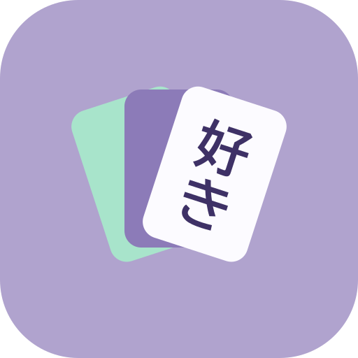

# Flashcards PWA

Offline flashcards that install to your phone's home screen. No App Store, no account, no server. Your data stays on your device.

I built this for my partner: she wanted a flashcard app on her iPhone and none of the existing ones, free or paid, fit how she studies. A native app meant a developer fee and App Store review, so I made it a PWA instead.

**Live app:** https://flashcards.hzinchenko.com/

<p>
  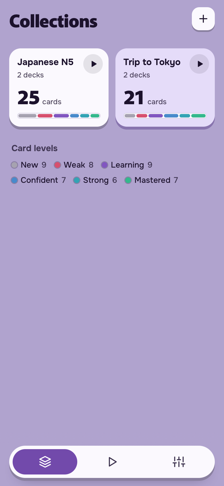
  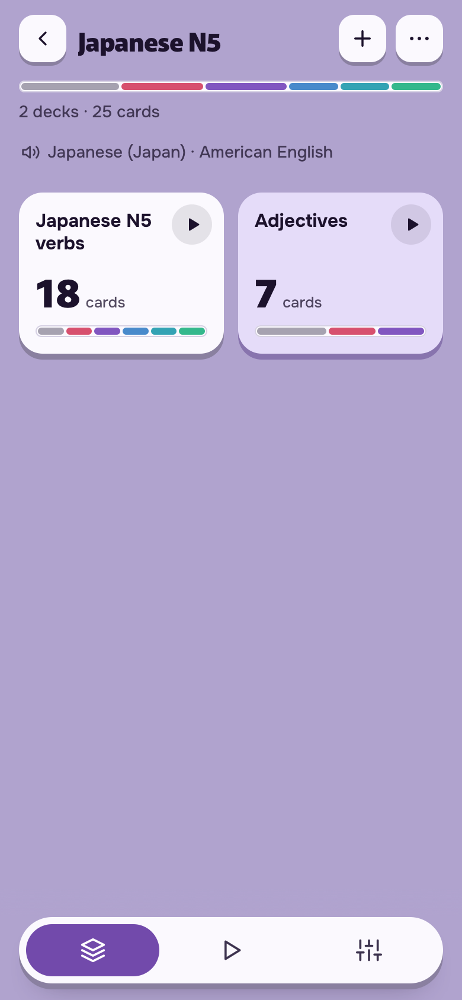
  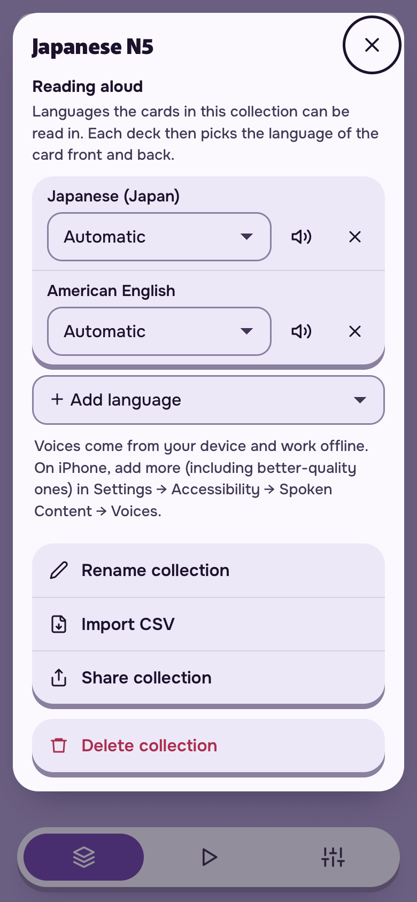
  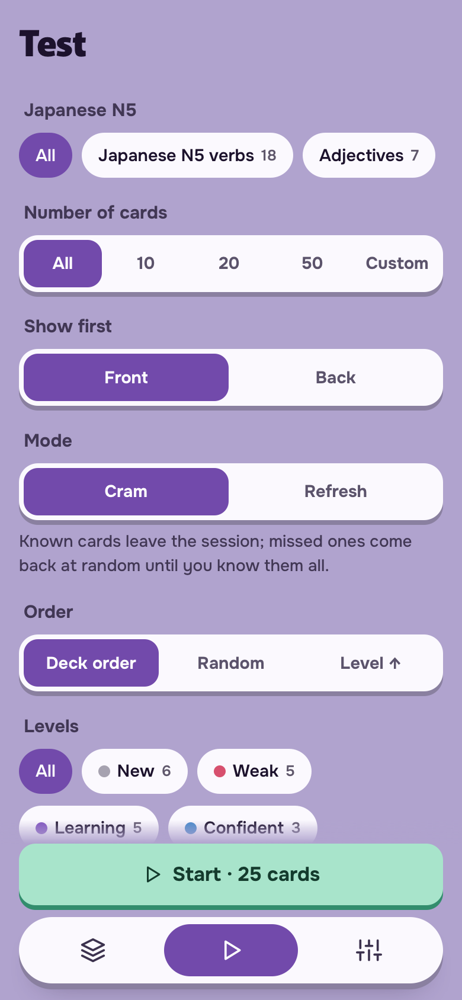
  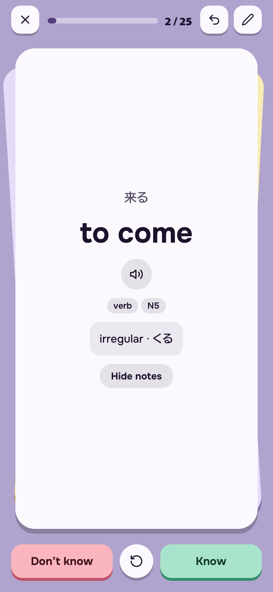
  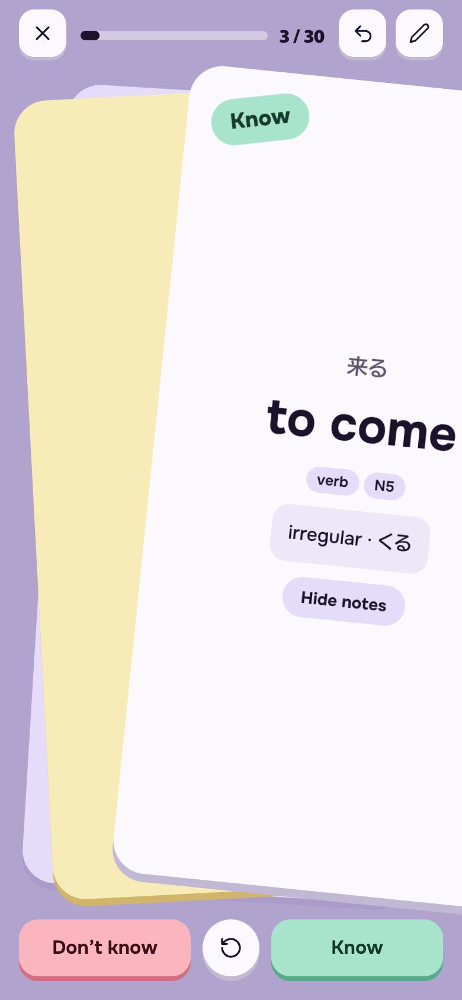
  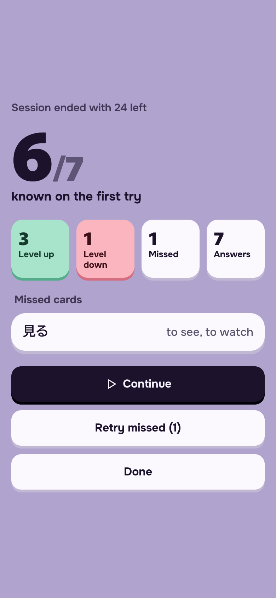
  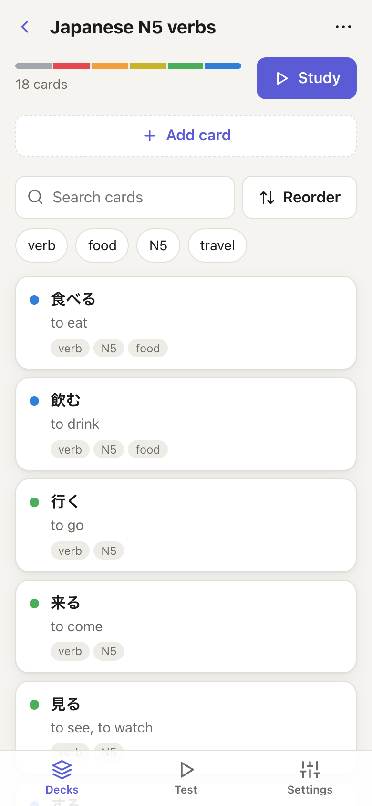
  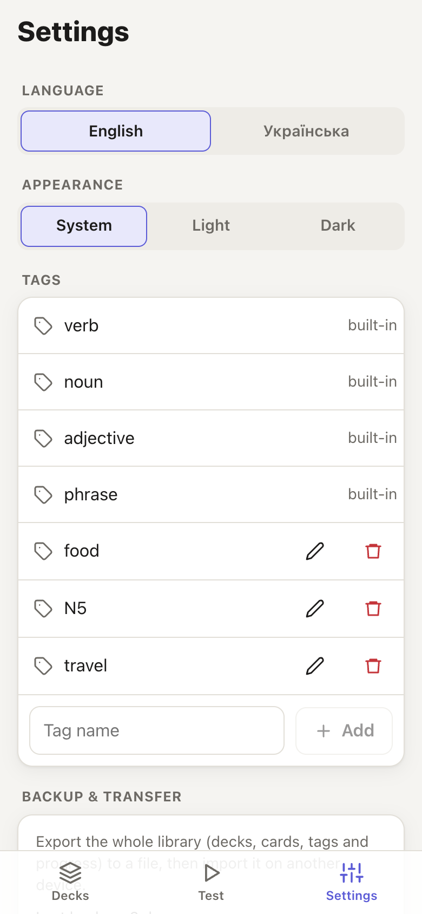
  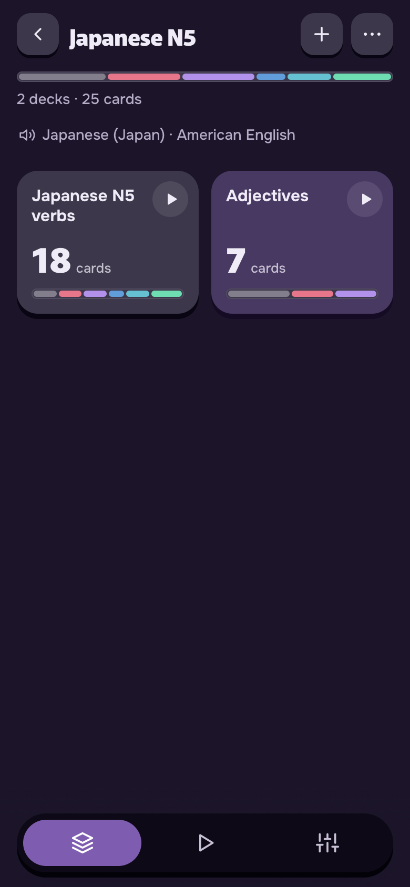
</p>

## Features

- **Collections:** decks are grouped into collections (one language, one course). The home screen lists collections; open one to see its decks. Decks can be moved between collections from the deck's ⋯ menu.
- **One-tap study:** the ▶ button on a collection or deck starts a session with its cards, keeping your usual direction, mode, order and card count.
- **Decks & cards:** create, rename and delete decks; add, edit, reorder and move cards, with optional notes per card. Quick-add form: Enter moves to the next field, Enter again saves. Deleting a card can be undone from the toast. The deck's ⋯ menu can also swap front and back of every card or reset its progress. A deck holds up to 999 cards, so it opens and searches quickly.
- **Tags:** built-in `verb`, `noun`, `adjective`, `phrase`, plus your own.
- **Learning levels:** New → Weak → Learning → Confident → Strong → Mastered. *Know* moves a card up one level, *Don't know* moves it down one. There is no scheduling: you choose what to study. Every collection and deck shows a colored bar of its levels, and the home screen has a legend with totals per level.
- **Test mode**
  - The Test tab uses the collection you opened last. Pick one or more of its decks and how many cards, then the rest of the options, all on one screen:
    - show the front or back first;
    - *Cram*: known cards leave the session, missed ones go back at a random spot until you know them all. *Refresh*: one pass, answers only update levels;
    - order: deck order, random, level ascending (weakest first);
    - filter by level and tag.
  - Gestures: **tap** flips · **swipe right** = know · **swipe left** = don't know · **swipe down** = edit card. A **Notes** button on both sides of the card reveals its notes.
  - **Undo last answer** (header button) puts the card back and restores its level.
  - Keyboard: Space / ↑ / ↓ flip · → know · ← don't know · S reads aloud · Z or Backspace undo · E edits · Esc finishes.
  - The summary leads with how many cards you knew on the first try and lists the ones you missed. **Retry missed** studies just those. If you stop early, **Continue** picks up where you left off; **Done** goes back to where you started.
  - If the phone closes the app mid-session (iOS does this to apps in the background), the next launch offers to **Resume** it.
- **Reading aloud:** a **speaker** button on the card reads that side with the device's built-in voices (works offline). A collection's settings (⋯) list the languages its cards can be read in, each with a voice to try and pick; then each deck's ⋯ → Reading aloud chooses the language of the card front and back (or off). With no languages, nothing is read. Settings → Reading aloud has a speed slider (0.5× to 1.5×) that reads an English sample when you let go.
- **Import / export**
  - JSON backup of the whole library (with progress), for moving to another device. Merge or replace on import.
  - CSV/TSV: `front,back,tags,notes` with tags separated by `|` (tags and notes optional). Handy for writing cards in Excel or Google Sheets on a PC. Import into a deck or a collection; *Share CSV* exports a deck, *Share collection* exports every deck of a collection with an extra `deck` column. Imported into a collection, a file with more than 999 cards is split into decks "Name", "Name 2"…
- Interface in English, Ukrainian, Spanish, German, French, Japanese, Portuguese, Italian, Turkish, Dutch and Chinese. Appearance: System, Light or Dark. Works offline.
- **Feedback:** Settings → About has a contact email and can copy diagnostics for a bug report when something goes wrong.

## Install on a phone

**iPhone (Safari):** open the link → Share → **Add to Home Screen**.

> ⚠️ On iOS the home-screen app has **its own storage, separate from Safari**. Install the app first, then add your cards inside it. To move data, use Settings → Export library / Import backup.

**Android (Chrome):** open the link → *Install app* (or use the Install button in the app).

## CSV format

```csv
front,back,tags,notes
食べる,to eat,verb|N5,ichidan verb
水,water,noun,
おはようございます,good morning,phrase,polite
```

The header row is optional. Comma, tab and semicolon separators are all detected automatically. Imported into a collection, an optional fifth `deck` column puts each card into the deck with that name.

## Your data

Everything lives in the browser's IndexedDB on your device. Nothing is sent anywhere. The app asks the browser to keep storage persistent (you can also do it in Settings), but the browser can still clear it, so export a backup now and then. Settings shows when you last exported, and after 10 study sessions without a backup it reminds you (with a dot on the Settings tab).

## Updates

The app works offline from a cached copy. It checks for a new version every hour and whenever you come back to it, and shows a **Reload** prompt when one is out; tap it to switch. After an update, a **What's new** sheet lists what changed (it's also in Settings → About, next to the current version).

## Development

Requires Node 22.

```bash
npm install
npm run dev        # dev server
npm test           # unit tests (Vitest)
npm run check      # svelte-check / TypeScript
npm run build      # production build into dist/
npm run preview    # serve the build at http://localhost:4173/
npm run e2e        # end-to-end tests (Playwright, WebKit) against a fresh build
npm run perf       # load test with big libraries
npm run screenshots # retake the README screenshots from docs/demo/demo-backup.json
npm run icons      # regenerate PWA icons from public/icon.svg
npm run og-image   # re-render public/og-image.png from docs/og/og-image.html (macOS Chrome)
```

Stack: Svelte 5 (runes) + TypeScript + Vite, Dexie (IndexedDB), vite-plugin-pwa (Workbox), PapaParse.

```
src/
  routes/        screens: Decks (collections home), Collection, Deck, TestSetup, TestRun, Settings
  components/    shared UI (modals, card editor, swipe card, tag picker…)
  lib/
    db.ts        Dexie schema
    repo/        database reads and writes (collections, decks, cards, tags, library import)
    io/          CSV and JSON backup parsing, file save/pick
    learning.ts  level changes
    session.ts   test filtering, ordering and the cram/refresh session
    gestures.ts  swipe classification
    i18n/        English (source of truth) and Ukrainian strings
tests/           Vitest unit tests (pure logic, plus the database layer against fake-indexeddb)
e2e/             Playwright tests, load test and README screenshots
```

## Release & deploy

Releases are deployed to GitHub Pages by pushing a version tag (`.github/workflows/deploy.yml`). The workflow checks that the tag matches the `version` in `package.json`, runs the tests, builds and deploys.

```bash
npm version patch          # or minor / major: bumps package.json, commits, tags vX.Y.Z
git push --follow-tags
```

Then create a GitHub release from the tag with notes. To redeploy an existing release, run the workflow by hand from the Actions tab and pick the tag.

Pushes to `main` and pull requests run type checks, tests and a build without deploying (`.github/workflows/ci.yml`).

One-time setup:
- **Settings → Pages → Source:** GitHub Actions.
- **Settings → Environments → github-pages → Deployment branches and tags:** add a tag rule `v*`.
- **Settings → Pages → Custom domain:** `flashcards.hzinchenko.com`, with Enforce HTTPS. DNS has a `CNAME` from `flashcards` to `hlib-zinchenko.github.io`.

The app is served from the root of its domain (`base: '/'`). To host it under a path instead, update `base` in `vite.config.ts` and the icon paths in `index.html`. Changing the address moves nobody's data: each user has to export a backup at the old address and import it at the new one.

## License

MIT
