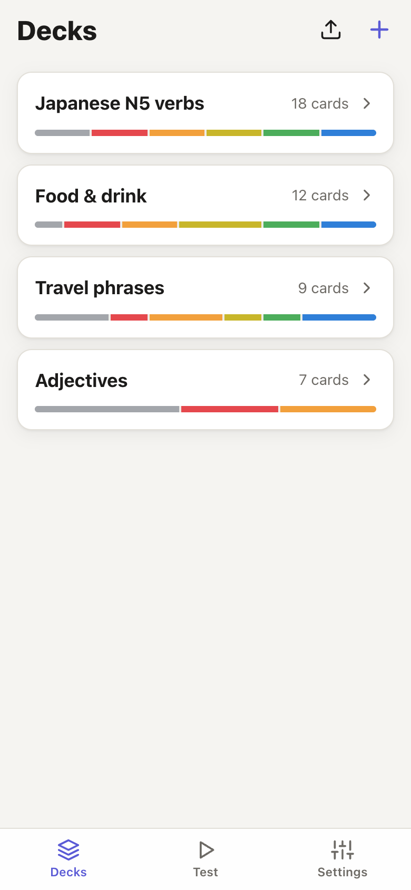
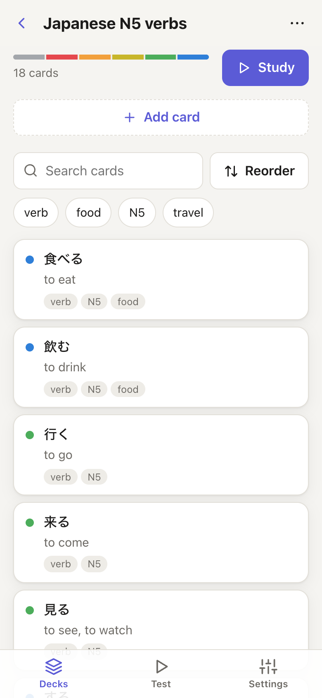
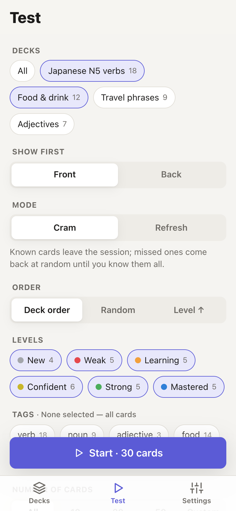
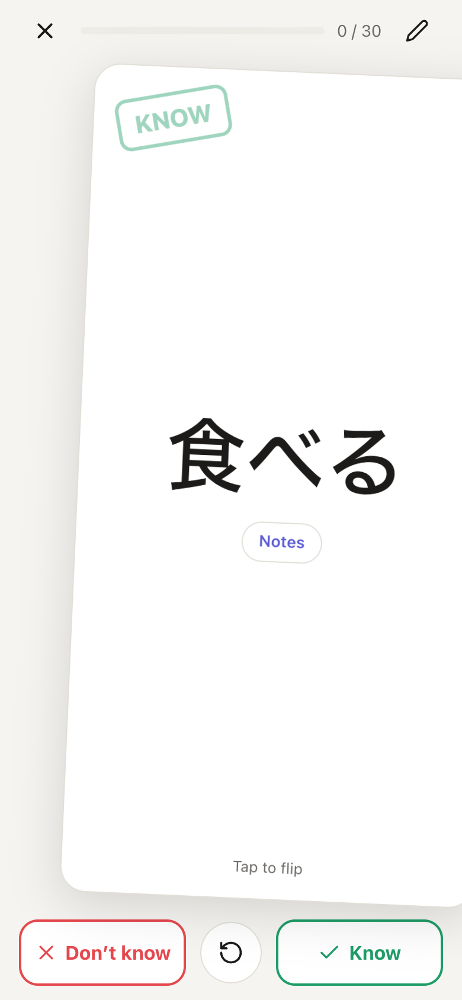
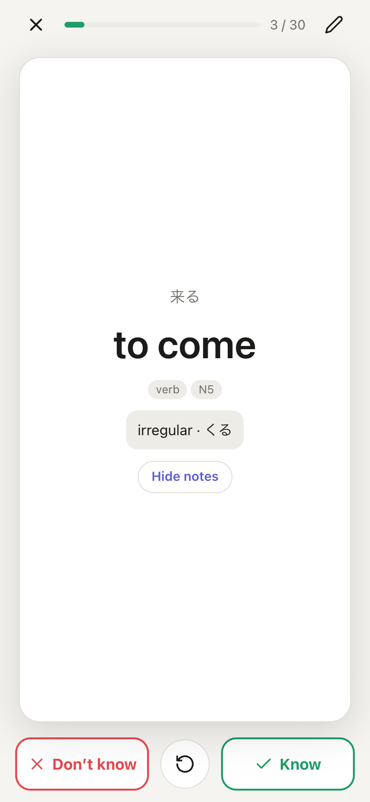
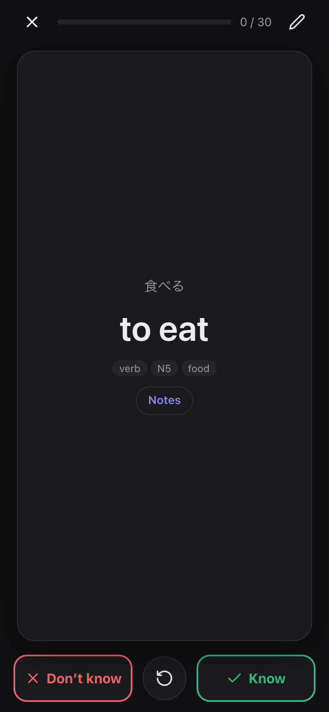

# Flashcards PWA

Offline flashcards that install to your phone's home screen. No App Store, no account, no server. Your data stays on your device.

I built this for my partner: she wanted a flashcard app on her iPhone and none of the existing ones, free or paid, fit how she studies. A native app meant a developer fee and App Store review, so I made it a PWA instead.

**Live app:** https://hlib-zinchenko.github.io/flashcards-pwa/

<p>
  
  
  
  
  
  
</p>

## Features

- **Decks & cards:** create, rename and delete decks; add, edit, reorder and move cards, with optional notes per card. Quick-add form: Enter moves to the next field, Enter again saves.
- **Tags:** built-in `verb`, `noun`, `adjective`, `phrase`, plus your own.
- **Learning levels:** New → Weak → Learning → Confident → Strong → Mastered. *Know* moves a card up one level, *Don't know* moves it down one. There is no scheduling: you choose what to study.
- **Test mode**
  - Pick one or more decks, show the front or back first.
  - *Cram*: known cards leave the session, missed ones go back at a random spot until you know them all. *Refresh*: one pass, answers only update levels.
  - Order: deck order, random, level ascending (weakest first).
  - Filter by level and tag, and limit the number of cards.
  - Gestures: **tap** flips · **swipe right** = know · **swipe left** = don't know · **swipe down** = edit card. A **Notes** button on both sides of the card reveals its notes.
  - Keyboard: Space / ↑ / ↓ flip · → know · ← don't know · E edits · Esc finishes.
- **Import / export**
  - JSON backup of the whole library (with progress), for moving to another device. Merge or replace on import.
  - CSV/TSV per deck: `front,back,tags,notes` with tags separated by `|` (tags and notes optional). Handy for writing cards in Excel or Google Sheets on a PC.
- English and Ukrainian UI, light and dark theme, works offline.

## Install on a phone

**iPhone (Safari):** open the link → Share → **Add to Home Screen**.

> ⚠️ On iOS the home-screen app has **its own storage, separate from Safari**. Install the app first, then add your cards inside it. To move data, use Settings → Export library / Import backup.

**Android (Chrome):** open the link → *Install app* (or use the Install button in the app).

## CSV format

```csv
front,back,tags,notes
食べる,to eat,verb|N5,ichidan verb
水,water,noun,
おはようございます,good morning,phrase,polite
```

The header row is optional. Comma, tab and semicolon separators are all detected automatically.

## Your data

Everything lives in the browser's IndexedDB on your device. Nothing is sent anywhere. The app asks the browser to keep storage persistent (you can also do it in Settings), but the browser can still clear it, so export a backup now and then.

## Updates

The app works offline from a cached copy. When a new version is deployed, it shows a **Reload** prompt; tap it to switch. The current version is shown in Settings → About.

## Development

Requires Node 22.

```bash
npm install
npm run dev        # dev server
npm test           # unit tests (Vitest)
npm run check      # svelte-check / TypeScript
npm run build      # production build into dist/
npm run preview    # serve the build at http://localhost:4173/flashcards-pwa/
npm run icons      # regenerate PWA icons from public/icon.svg
```

Stack: Svelte 5 (runes) + TypeScript + Vite, Dexie (IndexedDB), vite-plugin-pwa (Workbox), PapaParse.

```
src/
  routes/        screens: Decks, Deck, TestSetup, TestRun, Settings
  components/    shared UI (modals, card editor, swipe card, tag picker…)
  lib/
    db.ts        Dexie schema
    repo/        database reads and writes (decks, cards, tags, library import)
    io/          CSV and JSON backup parsing, file save/pick
    learning.ts  level changes
    session.ts   test filtering, ordering and the cram/refresh session
    gestures.ts  swipe classification
    i18n/        English (source of truth) and Ukrainian strings
tests/           Vitest unit tests for the pure logic in lib/
```

## Release & deploy

Releases are deployed to GitHub Pages by pushing a version tag (`.github/workflows/deploy.yml`). The workflow checks that the tag matches the `version` in `package.json`, runs the tests, builds and deploys.

```bash
npm version patch          # or minor / major: bumps package.json, commits, tags vX.Y.Z
git push --follow-tags
```

Then create a GitHub release from the tag with notes. To redeploy an existing release, run the workflow by hand from the Actions tab and pick the tag.

Pushes to `main` and pull requests run type checks, tests and a build without deploying (`.github/workflows/ci.yml`).

One-time setup:
- **Settings → Pages → Source:** GitHub Actions.
- **Settings → Environments → github-pages → Deployment branches and tags:** add a tag rule `v*`.

If you rename the repo, update `base` in `vite.config.ts` and the icon paths in `index.html`.

## License

MIT
